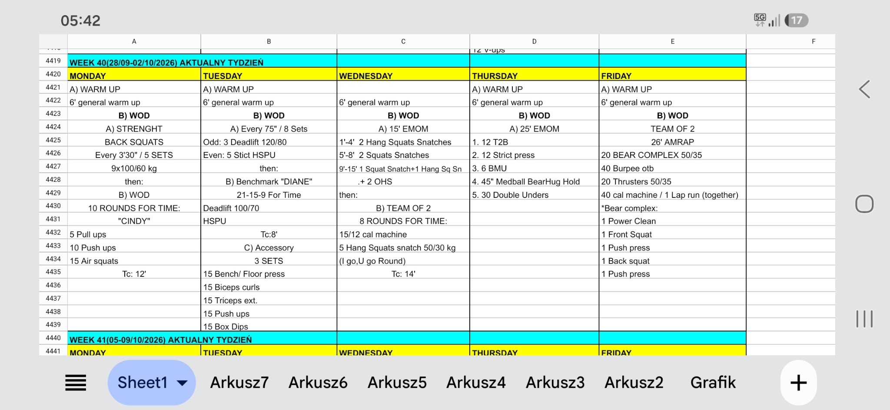

# Week 40 (28/09-02/10/2026)

## Source Screenshot

[Open source screenshot](../../../assets/images/week_40_source.jpeg)

## Overview

Transcribed from the week 40 source board screenshot (single-group start, 60-minute cap). Warmups are 15 min with group-flow notes.

## Daily Workouts

- **[Monday](monday.md)** - Back squat 9×100/60 (E3:30 × 5), then Cindy 10 rounds for time (TC 12')
- **[Tuesday](tuesday.md)** - E75s × 8 alternating heavy DL / strict HSPU, Diane 21-15-9 (TC 8'), then accessory pump
- **[Wednesday](wednesday.md)** - 15' snatch EMOM progression, then team-of-2 IGYG cal + hang squat snatch (TC 14')
- **[Thursday](thursday.md)** - 25' EMOM: T2B / strict press / BMU / medball bear-hug hold / DU
- **[Friday](friday.md)** - Team-of-2 26' AMRAP: bear complex / burpee OTB / thrusters / cal or lap together

## Lesson Planning Notes

- Keep every day on a hard 60-minute clock with a single-group start.
- **Warmups are 15 min** with Flow (setup before 0:00, workout groups/lanes, coach-called clock, 13:00-15:00 load transition).
- Preserve stimulus by scaling load first, then volume, then complexity/ROM.
- Pre-brief partner rules (Wed IGYG full round; Fri split complex + together lap option).
- Tuesday is tight — protect Diane quality; accessory is steady, not a race.
- Thursday scale BMU early so all five EMOM cycles stay finishable with rest.
