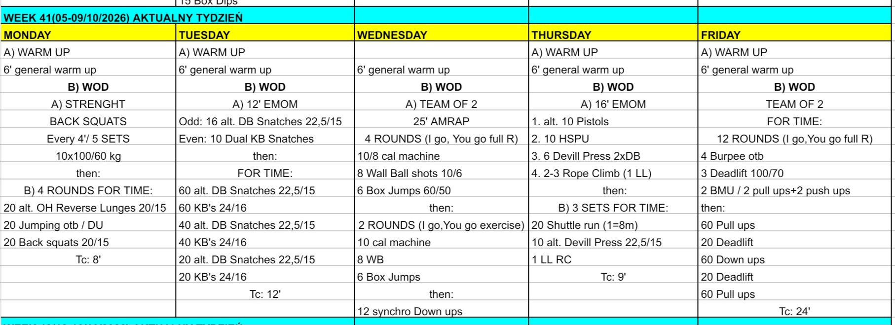

# Week 41 (05-09/10/2026)

## Source Screenshot

[Open source screenshot](../../../assets/images/week_41_source.jpeg)

## Overview

Transcribed from the week 41 source board screenshot (single-group start, 60-minute cap). Warmups are 15 min with group-flow notes.

Two loads are blank on the board: Tuesday dual kettlebell snatch, and Thursday EMOM two-dumbbell devil press. Both files tell the coach to set a load that finishes inside the minute. Board text “KB's” is programmed as kettlebell swings. Board text “1 LL” is a legless rope climb.

## Daily Workouts

- **[Monday](monday.md)** - Back squat 10×100/60 (every 4:00 × 5), then 4 rounds OH reverse lunge / jump-over-bar or DU / back squat 20/15 (TC 8')
- **[Tuesday](tuesday.md)** - 12' EMOM alternating DB snatch and dual KB snatch, then 60-40-20 DB snatch + KB swing (TC 12')
- **[Wednesday](wednesday.md)** - Team-of-2 25' AMRAP: 4 full rounds + 2 by-exercise rounds of cal / wall ball / box jump, then 12 synchro down-ups
- **[Thursday](thursday.md)** - 16' EMOM pistol / HSPU / devil press / legless rope, then 3 shuttle + devil press + rope sets (TC 9')
- **[Friday](friday.md)** - Team-of-2 for time: 12 IGYG rounds burpee OTB / DL / BMU, then split pull-up and deadlift chipper (TC 24')

## Lesson Planning Notes

- Keep every day on a hard 60-minute clock with a single-group start.
- **Warmups are 15 min** with Flow (setup before 0:00, workout groups/lanes, coach-called clock, 13:00-15:00 load transition).
- Preserve stimulus by scaling load first, then volume, then complexity/ROM.
- Monday: the 4:00 squat rest is the strength piece. Strip to 20/15 before the 8' cap.
- Wednesday: brief three handoffs before the clock — full round, by exercise, then synchronized down-ups.
- Thursday: one rope per athlete, or pair the rope and drop to 1 climb. Shuttle is 8 m, not a lap.
- Friday: start the for-time by ~0:20. Muscle-up scale is on the board (2 pull-ups + 2 push-ups). Chipper is split; deadlifts stay 100/70.
