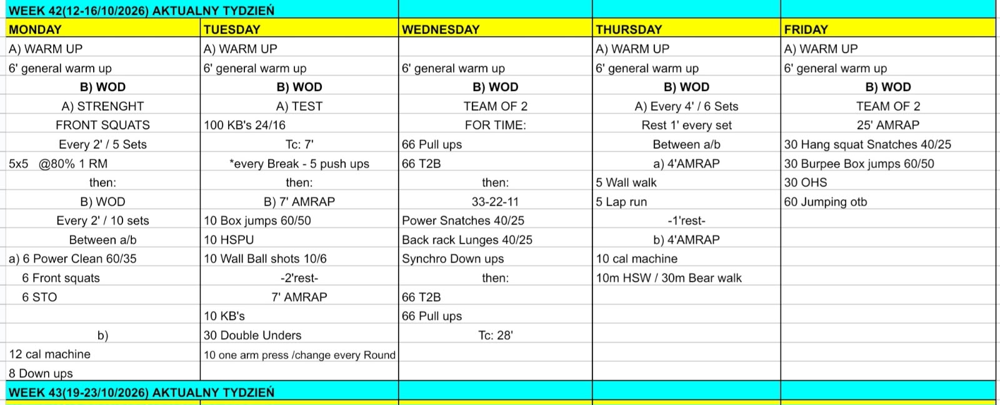

# Week 42 (12-16/10/2026)

## Source Screenshot

[Open source screenshot](../../../assets/images/week_42_source.jpeg)

## Overview

Transcribed from the week 42 source board (single-group start, 60-minute cap). Warmups are 15 min with group-flow notes.

Board calls, so the files stay usable on the floor:

- “STO” is shoulder-to-overhead on the same bar as the power clean and front squat.
- “5x5” is 5 front squats for 5 sets at 80% 1RM, every 2:00.
- “KB's” is kettlebell swings. A break on Tuesday’s test is letting go of the bell.
- The one-arm press has no load on the board. It uses the same 24/16 kettlebell. Switch arms each round.
- “Jumping otb” is jumps over the bar.
- “10m HSW / 30m Bear walk” is the board’s pair: handstand walk, or bear walk.
- 1 lap = 350 m. Thursday’s 5-lap round is 1,750 m, so the working odd-set score is wall walks plus about 1 lap.
- Team reps are split. Wednesday’s down-ups are the only piece marked synchro.
- Thursday is 6 sets of a 4:00 AMRAP plus 1:00 rest, alternating a and b.

## Daily Workouts

- **[Monday](monday.md)** - Front squat 5 @ 80% (every 2:00 × 5), then every 2:00 × 10 alternating power clean / front squat / STO with cal + down-ups
- **[Tuesday](tuesday.md)** - 100 KB swings 24/16 (TC 7', 5 push-ups per break), then 7' box / HSPU / wall ball, 2' rest, 7' swings / DU / one-arm press
- **[Wednesday](wednesday.md)** - Team-of-2 for time: 66 pull-ups + 66 T2B, 33-22-11 snatch / lunge / synchro down-up, 66 T2B + 66 pull-ups (TC 28')
- **[Thursday](thursday.md)** - 6 × 4:00 AMRAP, 1:00 rest, alternate wall walk + lap run with cal + handstand walk or bear walk
- **[Friday](friday.md)** - Team-of-2 25' AMRAP: hang squat snatch, burpee box jump, overhead squat, jumps over the bar

## Lesson Planning Notes

- Keep every day on a hard 60-minute clock with a single-group start.
- Warmups are 15 min with Flow (setup before 0:00, workout groups, coach-called clock, 13:00-15:00 transition).
- Preserve stimulus by scaling load first, then volume, then complexity/ROM.
- Monday: if the 5th rep grinds on set 1, drop the load before set 2. Strip to 60/35 inside a 2-minute reset.
- Tuesday: say the break rule before the test. The 2:00 between AMRAPs is rest.
- Wednesday: brief split vs synchronized before the clock. Start the for-time by ~0:19.
- Thursday: mark the 350 m loop before 0:00. Machines are the even sets only.
- Friday: one bar and one box per team. Start the AMRAP by ~0:20.
